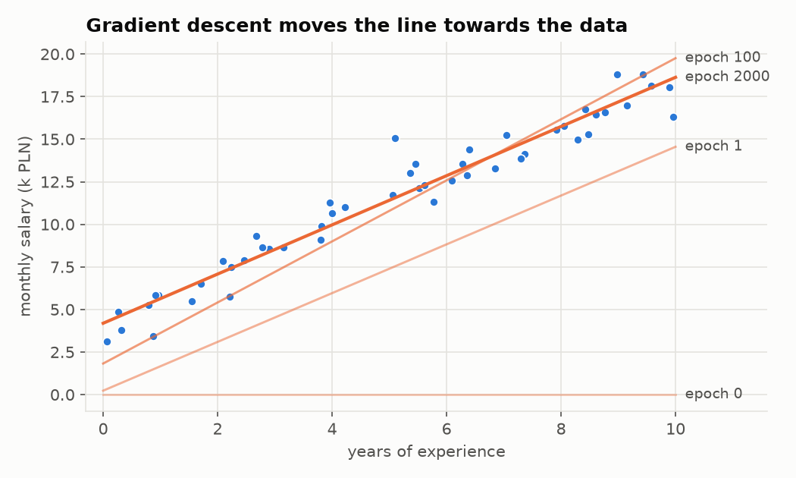
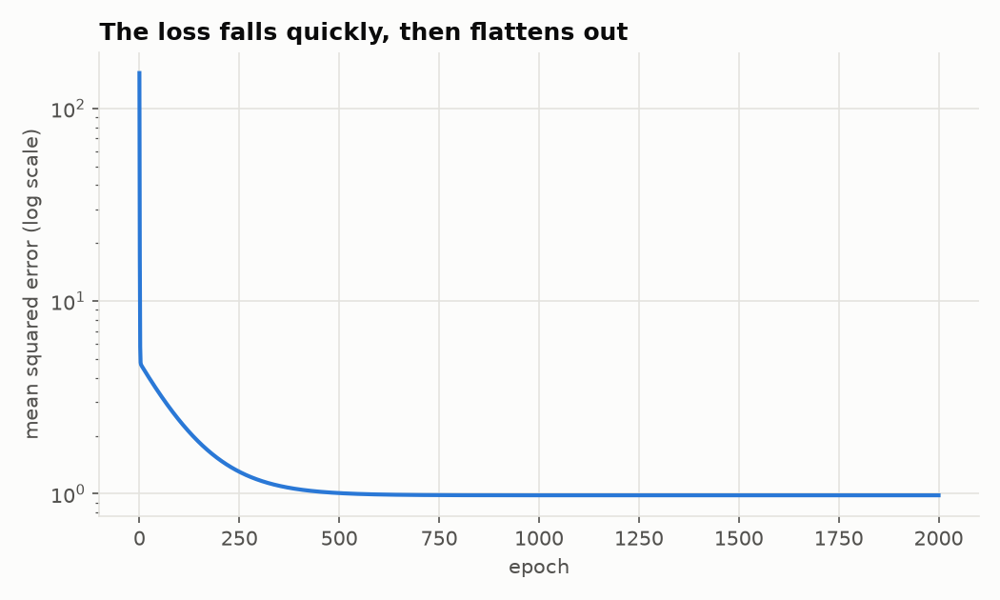
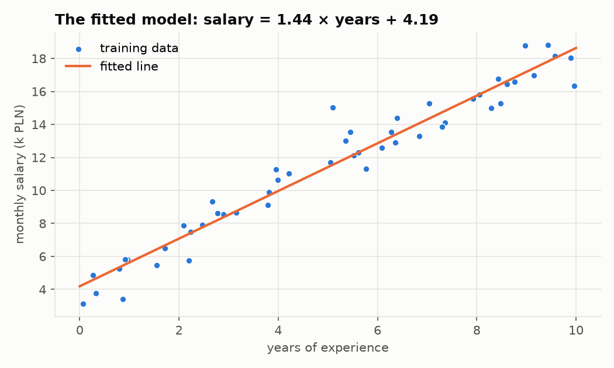
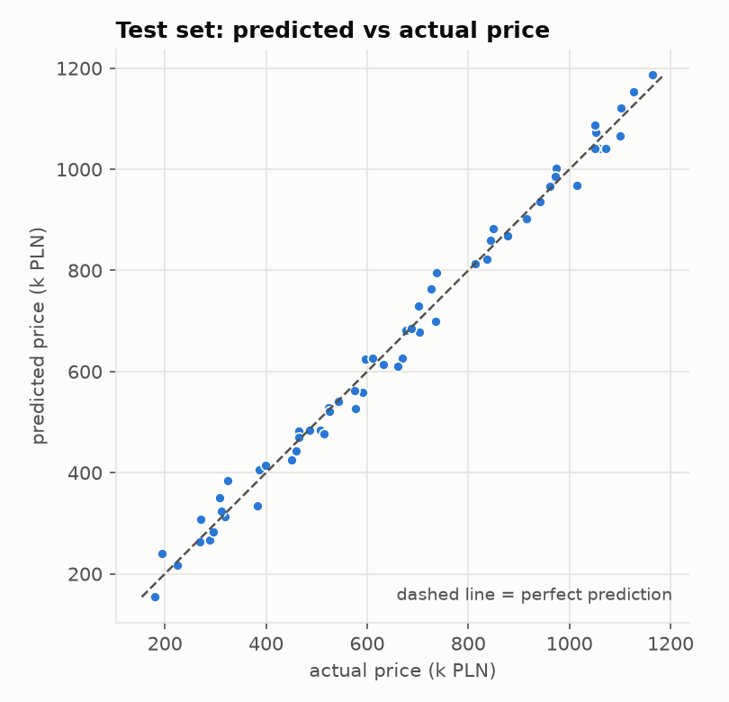

# Linear regression: a first step into machine learning

Linear regression is the "hello world" of machine learning. The model is just a
straight line, but fitting it uses the same four ingredients as training a
neural network with billions of parameters:

| Ingredient | In this tutorial | In general |
|---|---|---|
| **Data** | years of experience → salary | examples of inputs with known answers |
| **Model** | `y = w·x + b` | a formula with adjustable numbers (*parameters*) |
| **Loss** | mean squared error | one number that says how wrong the model is |
| **Optimiser** | gradient descent | a procedure that changes the parameters to lower the loss |

Understand these four on a straight line and you have understood the core loop
of machine learning. Everything later is a variation: a more flexible model, a
different loss, a smarter optimiser.

## How to use this tutorial

Read a section, then open and run the matching script. The scripts are short
and heavily commented; they are meant to be read, changed and broken.

```bash
cd linear-regression

# Lesson 1 needs nothing but Python 3
python3 01_from_scratch.py

# Lessons 2-4 need numpy, matplotlib and scikit-learn
python3 -m venv .venv
source .venv/bin/activate
pip install -r requirements.txt
python 02_numpy_and_normal_equation.py
python 03_multiple_features.py
python 04_scikit_learn.py
```

| File | What it teaches |
|---|---|
| [`01_from_scratch.py`](01_from_scratch.py) | model, loss and gradient descent in pure Python |
| [`02_numpy_and_normal_equation.py`](02_numpy_and_normal_equation.py) | vectorised code, and the exact closed-form solution |
| [`03_multiple_features.py`](03_multiple_features.py) | many inputs, train/test split, feature scaling, R² |
| [`04_scikit_learn.py`](04_scikit_learn.py) | the same model with the library you would use in practice |
| [`datasets.py`](datasets.py) | generates the synthetic data |
| [`plotting.py`](plotting.py) | shared chart styling |

The data is synthetic on purpose. Because we generate it from a known formula
plus random noise, we can check whether the model recovers the truth, which is
something you can never do with real data.

---

## 1. The problem

We have 50 people. For each we know their years of experience (`x`) and their
monthly salary in thousand PLN (`y`). We want a rule that predicts the salary
of someone who is *not* in the data.

This is **supervised learning**: we learn from examples where the right answer
is known. It is **regression** because the answer is a number (predicting a
category, such as spam / not spam, is called *classification*).

## 2. The model

We assume the relationship is roughly a straight line:

$$\hat{y} = w \cdot x + b$$

- $\hat{y}$ ("y hat") is the model's prediction
- $w$ is the **weight** (slope): how much salary grows per extra year
- $b$ is the **bias** (intercept): the predicted salary at zero experience

`w` and `b` are the **parameters**. "Training" or "learning" means nothing more
than finding good values for them.

```python
def predict(x, w, b):
    return w * x + b
```

## 3. The loss: measuring how wrong we are

To find *good* parameters we first need to define *good*. For every example we
compare the prediction with the real answer, square the difference, and take
the average. This is the **mean squared error** (MSE):

$$L(w, b) = \frac{1}{n} \sum_{i=1}^{n} (w x_i + b - y_i)^2$$

Why square the errors?

- positive and negative errors no longer cancel each other out
- big mistakes are punished much more than small ones
- the result is a smooth bowl-shaped function of `w` and `b` with exactly one
  minimum, which makes it easy to optimise

The loss turns "find the best line" into a precise mathematical task: **find
the `w` and `b` that make `L` as small as possible.**

## 4. Gradient descent: learning by walking downhill

Picture the loss as a landscape: every point on the ground is a pair `(w, b)`,
and the height is the loss there. We start somewhere (here: `w = 0, b = 0`)
and want to reach the lowest point, but we can only feel the slope under our
feet. So we take a small step downhill, feel the slope again, and repeat.

The slope is the **gradient**: the derivative of the loss with respect to each
parameter. For MSE it works out to:

$$\frac{\partial L}{\partial w} = \frac{2}{n} \sum_{i=1}^{n} (w x_i + b - y_i) \cdot x_i
\qquad
\frac{\partial L}{\partial b} = \frac{2}{n} \sum_{i=1}^{n} (w x_i + b - y_i)$$

(This is the chain rule applied to the square: the derivative of
$(\text{error})^2$ is $2 \cdot \text{error}$ times the derivative of the error,
which is $x_i$ for `w` and $1$ for `b`.)

The gradient points uphill, so we step the opposite way:

$$w \leftarrow w - \alpha \frac{\partial L}{\partial w}
\qquad
b \leftarrow b - \alpha \frac{\partial L}{\partial b}$$

$\alpha$ is the **learning rate**, the size of each step. It is a
**hyperparameter**: a setting *you* choose, as opposed to a parameter the
model learns.

- too small: learning works but takes forever
- too large: every step overshoots the minimum and the loss explodes

One pass over the whole dataset is called an **epoch**. The entire training
loop in [`01_from_scratch.py`](01_from_scratch.py) is:

```python
w, b = 0.0, 0.0
for epoch in range(epochs):
    grad_w, grad_b = gradients(xs, ys, w, b)
    w -= learning_rate * grad_w
    b -= learning_rate * grad_b
```

Running it:

```
epoch    0   w =  0.000   b =  0.000   loss = 152.8004
epoch  200   w =  1.656   b =  2.752   loss =   1.5071
epoch  400   w =  1.523   b =  3.659   loss =   1.0539
...
epoch 2000   w =  1.444   b =  4.190   loss =   0.9822

learned:  salary = 1.444 * years + 4.190
truth:    salary = 1.500 * years + 4.000  (+ noise)
```





Three things worth noticing:

1. **The model found the hidden rule from examples alone.** We never told it
   that the slope is 1.5; it worked that out from 50 noisy points.
2. **It is close, not exact.** With only 50 noisy examples the best line for
   *this sample* is slightly different from the true one. More data would bring
   it closer.
3. **The loss stops near 0.98, not 0.** The data was generated with random
   noise of variance 1. No line can predict randomness, so that is the floor.
   A loss that will not go lower is not always a bug.

## 5. Same thing, faster: numpy and the normal equation

[`02_numpy_and_normal_equation.py`](02_numpy_and_normal_equation.py) repeats
lesson 1 with numpy. Loops over examples become operations on whole arrays
(**vectorisation**):

```python
error = w * x + b - y                  # all 50 errors at once
w -= learning_rate * 2 * np.mean(error * x)
b -= learning_rate * 2 * np.mean(error)
```

It then shows something special about linear regression: because the loss is a
simple bowl, we can find the bottom *directly* by setting the gradient to zero
and solving. Stack the inputs into a matrix $X$ (with an extra column of ones
so the bias becomes just another weight) and the answer is the
**normal equation**:

$$\theta = (X^\top X)^{-1} X^\top y$$

```python
X = np.column_stack([x, np.ones_like(x)])
theta = np.linalg.solve(X.T @ X, X.T @ y)   # theta = [w, b]
```

```
gradient descent :  w = 1.4443   b = 4.1903
normal equation  :  w = 1.4442   b = 4.1905
```

Both methods agree. So why learn gradient descent at all? Because the shortcut
exists only for this model. Logistic regression, decision-tree boosting and
neural networks have no closed-form solution, and all of them are trained by
some form of gradient descent.



## 6. More than one feature

Real predictions depend on many inputs. In
[`03_multiple_features.py`](03_multiple_features.py) we predict an apartment's
price from its size, number of rooms, age and distance to the centre. The
model simply gets one weight per feature:

$$\hat{y} = w_1 x_1 + w_2 x_2 + w_3 x_3 + w_4 x_4 + b$$

The code is nearly unchanged, since `w` is now a vector and `X @ w` computes
all the sums. Geometrically the "line" becomes a flat plane in more dimensions,
which is why it is still called *linear* regression.

This lesson introduces three habits you will use in every ML project.

### Train / test split

A model can always look good on the data it was fitted to. What matters is how
it performs on data it has **never seen**. So before training we set aside 20%
of the examples as a **test set** and evaluate on it only at the end.

If a model does much better on the training set than on the test set, it has
memorised the examples instead of learning the pattern. That is
**overfitting**, the central problem of machine learning.

### Feature scaling

Run gradient descent on the raw apartment data and it blows up:

```
gradient descent on RAW features, learning rate 0.01:
  weights = [nan nan nan nan]   <- diverged
```

Size goes up to 120 while the number of rooms goes up to about 5. The loss
landscape becomes a long, narrow valley, and any step big enough to make
progress along it overshoots across it. The fix is **standardisation**:
rescale each feature to mean 0 and standard deviation 1.

```python
mean = X_train.mean(axis=0)
std = X_train.std(axis=0)
X_train_s = (X_train - mean) / std
X_test_s = (X_test - mean) / std     # reuse the TRAINING mean and std
```

The mean and standard deviation come from the training set only. Computing
them on all the data would let information from the test set leak into
training, and the test score would no longer be honest.

### Measuring quality

- **RMSE** (root mean squared error) is the typical size of an error, in the
  same unit as the target. Here: about 27k PLN on prices of 150k to 1200k.
- **R²** is the share of the variation in the target that the model explains.
  1.0 is perfect; 0.0 is no better than always predicting the average.

```
train  RMSE =   23.7k PLN    R^2 = 0.9930
test   RMSE =   27.4k PLN    R^2 = 0.9903
```

Train and test scores are close, so the model generalises well.



### Reading the model

A big strength of linear regression is that you can read what it learned:

```
  feature          learned      true
  size_m2             9.07      9.00
  rooms              16.14     15.00
  age_years          -1.11     -1.20
  km_to_centre      -12.56    -12.00
```

"Each extra square metre adds about 9k PLN, all else being equal." Few other
models are this easy to interpret, which is why linear regression is still
widely used in economics, medicine and anywhere a decision must be explained.

## 7. In practice: scikit-learn

Nobody writes gradient descent by hand at work.
[`04_scikit_learn.py`](04_scikit_learn.py) does all of lesson 3 in a few lines:

```python
X_train, X_test, y_train, y_test = train_test_split(X, y, test_size=0.2, random_state=0)

model = LinearRegression()
model.fit(X_train, y_train)
y_pred = model.predict(X_test)
```

`fit` and `predict` are the interface of almost every scikit-learn model, so
swapping in a different algorithm later is a one-line change. The numbers
differ slightly from lesson 3 because scikit-learn shuffles the data into a
different train/test split.

## 8. When linear regression is the wrong tool

- **The relationship is not a straight line.** If salary doubles every few
  years, no line fits. Plot the data first. (You can often rescue the model by
  adding transformed features such as `x²` or `log(x)`.)
- **Outliers.** Squaring errors means one extreme point can drag the whole
  line towards itself.
- **Extrapolation.** The model above would happily predict a salary for 60
  years of experience. Predictions far outside the training data are guesses.
- **Correlation is not causation.** A weight tells you what goes together in
  the data, not what causes what.
- **Strongly correlated features.** Size and rooms move together, so the model
  struggles to separate their effects. Notice that `rooms` came out at 16.1
  against a true value of 15, and lands somewhere else again (16.9) on the
  different split in lesson 4: its estimate is the least stable.

## 9. Exercises

Changing the code and predicting what will happen is where the understanding
actually forms.

1. In `01_from_scratch.py`, set `learning_rate` to `0.0001`, then to `0.05`.
   What happens to the loss in each case, and why?
2. Train for only 50 epochs. Is `w` or `b` further from its final value? Look
   at the learning figure above and explain why the bias is slower.
3. In `datasets.py`, raise the noise from `1.0` to `5.0`. How does the final
   loss change? How close are the learned parameters to the truth now?
4. Call `make_salary_data(n=5)` and then `n=5000`. How does the amount of data
   affect how well the true rule is recovered?
5. Add an outlier, for example `xs.append(1); ys.append(60)`, and see how far
   the line moves.
6. Replace the squared error with the absolute error `|ŷ − y|`. Its gradient
   is `sign(error) * x`. Repeat exercise 5: is the line more or less sensitive
   to the outlier?
7. In `03_multiple_features.py`, drop the `rooms` column. How much does R²
   change? What does that tell you about correlated features?

## 10. Vocabulary

| Term | Meaning |
|---|---|
| feature | an input variable (`x`) |
| target / label | the value we want to predict (`y`) |
| parameters | numbers the model learns (`w`, `b`) |
| hyperparameters | settings we choose (learning rate, number of epochs) |
| loss | a single number measuring how wrong the model is |
| gradient | the direction in which the loss grows fastest |
| epoch | one pass over the training data |
| training set / test set | data used to fit the model / data held back to judge it |
| overfitting | doing well on training data but poorly on new data |
| generalisation | doing well on data the model has never seen |

## Where to go next

1. **Logistic regression**: the same recipe with a different output and loss,
   used for yes/no predictions. The natural next tutorial.
2. **Polynomial features and regularisation** (Ridge, Lasso): making the model
   more flexible, then keeping it from overfitting.
3. **Neural networks**: many linear models stacked with non-linear functions
   in between, trained with the same gradient descent you just wrote.

For the theory in depth, see the linear regression chapter of
[*Data Mining and Machine Learning: Fundamental Concepts and Algorithms*](https://freecomputerbooks.com/Data-Mining-and-Machine-Learning-Fundamental-Concepts-and-Algorithms.html)
by Zaki and Meira.
