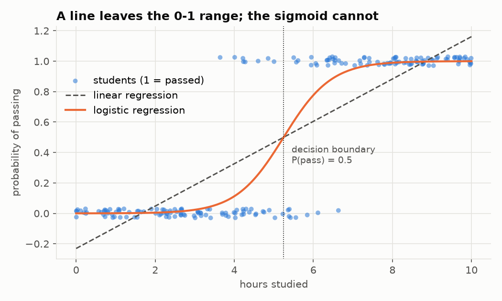
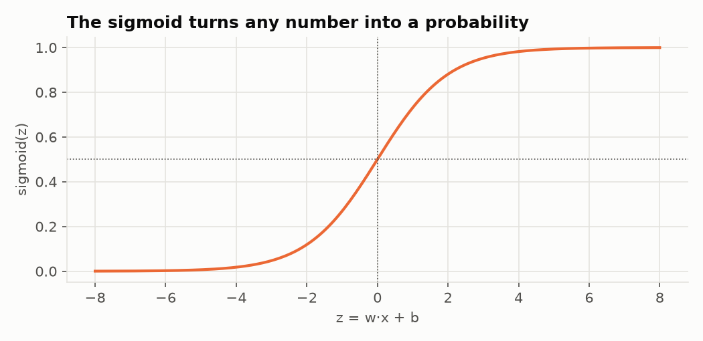
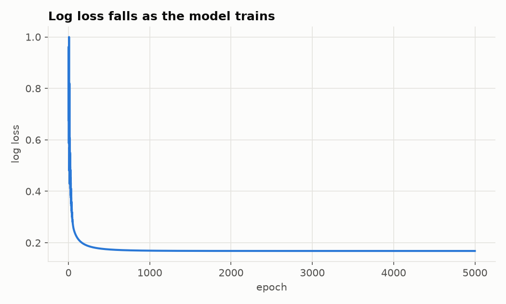
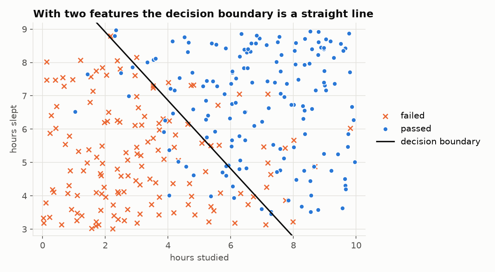
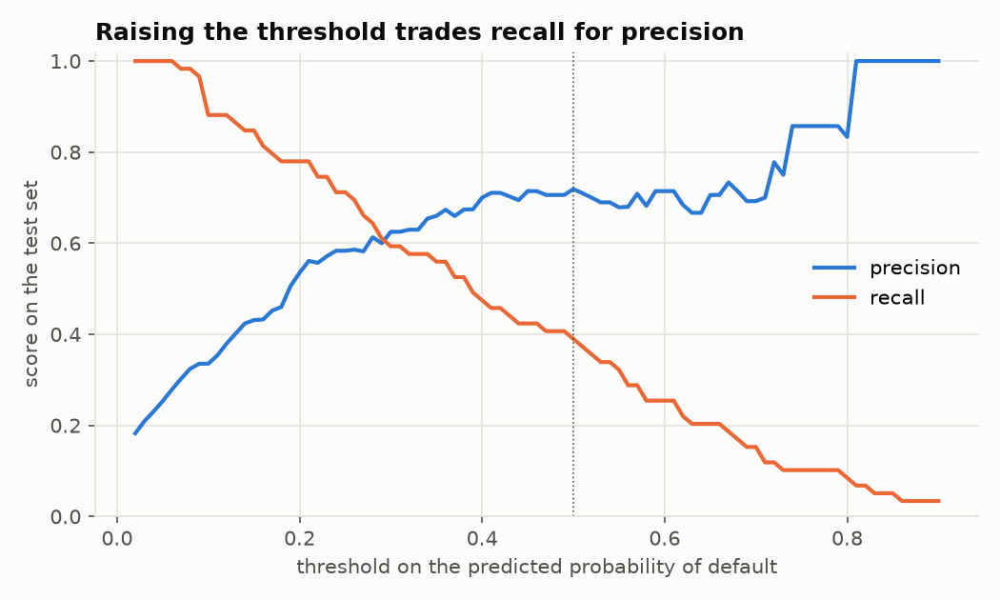

# Logistic regression: from predicting numbers to predicting yes or no

This tutorial follows on from [linear regression](../linear-regression/README.md).
There the answer was a number (a salary, a price). Here the answer is one of
two categories: pass or fail, spam or not spam, default or repay. That task is
called **binary classification**, and logistic regression is its simplest
model.

Despite the name, logistic regression is a *classification* algorithm. The
name is historical: it does regression on a probability.

The good news is that almost everything carries over. Of the four ingredients,
only two change:

| Ingredient | Linear regression | Logistic regression |
|---|---|---|
| **Data** | answers are numbers | answers are 0 or 1 |
| **Model** | `ŷ = w·x + b` | `p = sigmoid(w·x + b)` |
| **Loss** | mean squared error | log loss (cross-entropy) |
| **Optimiser** | gradient descent | gradient descent, unchanged |

## How to use this tutorial

Read a section, then open and run the matching script.

```bash
cd logistic-regression

# Lesson 1 needs nothing but Python 3
python3 01_from_scratch.py

# Lessons 2-4 need numpy, matplotlib and scikit-learn
python3 -m venv .venv
source .venv/bin/activate
pip install -r requirements.txt
python 02_numpy_and_decision_boundary.py
python 03_evaluating_a_classifier.py
python 04_scikit_learn.py
```

| File | What it teaches |
|---|---|
| [`01_from_scratch.py`](01_from_scratch.py) | sigmoid, log loss and gradient descent in pure Python |
| [`02_numpy_and_decision_boundary.py`](02_numpy_and_decision_boundary.py) | vectorised code, the S-curve, the decision boundary |
| [`03_evaluating_a_classifier.py`](03_evaluating_a_classifier.py) | baseline, confusion matrix, precision, recall, thresholds |
| [`04_scikit_learn.py`](04_scikit_learn.py) | the same model with the library you would use in practice |
| [`datasets.py`](datasets.py) | generates the synthetic data |
| [`plotting.py`](plotting.py) | shared chart styling |

---

## 1. The problem

200 students took an exam. For each we know how many hours they studied (`x`)
and whether they passed (`y = 1`) or failed (`y = 0`). We want to predict the
outcome for a new student.

Notice that the data is not clean-cut. Some students passed after 4 hours and
some failed after 6. So the honest answer for a new student is not "pass" or
"fail" but a **probability**: "about 78% likely to pass". That is exactly what
logistic regression outputs.

## 2. Why not just use linear regression?

We could fit a straight line to the 0/1 labels. The dashed line below is what
we get:



The line predicts a "probability" of −0.23 for someone who did not study and
1.16 for someone who studied 10 hours. Probabilities below 0 or above 1 are
meaningless. A straight line is simply the wrong shape: we need something that
flattens out at 0 and at 1.

## 3. The model: a line pushed through the sigmoid

The fix is to keep the line, and then squash its output into the range 0 to 1
with the **sigmoid** (also called *logistic*) function:

$$\sigma(z) = \frac{1}{1 + e^{-z}}$$



- very negative `z` gives a value near 0
- `z = 0` gives exactly 0.5
- very positive `z` gives a value near 1

The full model is:

$$p = \sigma(w \cdot x + b)$$

and `p` is read as "the probability that the answer is 1".

```python
def predict_probability(x, w, b):
    return sigmoid(w * x + b)
```

The quantity `z = w·x + b` inside the sigmoid is called the **logit** or
**log-odds**. So the model is still linear at heart; it is linear in the
log-odds instead of in the answer itself.

To turn a probability into a decision we apply a **threshold**, usually 0.5:
predict 1 if `p ≥ 0.5`, otherwise 0.

## 4. The loss: log loss

Mean squared error is a poor fit here. Combined with the sigmoid it produces a
loss landscape with flat regions where gradient descent crawls, especially
when the model is confidently wrong, which is exactly when we want it to learn
fastest.

Instead we use **log loss** (also called **binary cross-entropy**). For one
example with predicted probability `p`:

- if the truth is 1, the loss is `−log(p)`
- if the truth is 0, the loss is `−log(1 − p)`

| Truth | Model says P(1) = | Loss |
|---|---|---|
| 1 | 0.99 | 0.01 |
| 1 | 0.50 | 0.69 |
| 1 | 0.01 | 4.61 |

Being confident and right costs almost nothing. Being confident and wrong is
punished heavily, and the penalty grows without limit as `p` approaches the
wrong extreme. Both cases fit into one formula, averaged over all examples:

$$L(w, b) = -\frac{1}{n} \sum_{i=1}^{n} \Big[ y_i \log(p_i) + (1 - y_i) \log(1 - p_i) \Big]$$

Where does it come from? It is the negative logarithm of the probability that
the model assigns to the labels we actually observed. Minimising log loss
means choosing the parameters under which the observed data is most likely
(**maximum likelihood**). And like MSE for linear regression, it is
bowl-shaped, with a single minimum.

## 5. Gradient descent, again

Working out the derivatives of the log loss gives a pleasant surprise:

$$\frac{\partial L}{\partial w} = \frac{1}{n} \sum_{i=1}^{n} (p_i - y_i) \cdot x_i
\qquad
\frac{\partial L}{\partial b} = \frac{1}{n} \sum_{i=1}^{n} (p_i - y_i)$$

This is "error times input", the same form as in linear regression. The
sigmoid and the logarithm cancel each other out neatly, which is one reason
they are paired. The training loop in
[`01_from_scratch.py`](01_from_scratch.py) is therefore identical to the one
you already know:

```python
w, b = 0.0, 0.0
for epoch in range(epochs):
    grad_w, grad_b = gradients(xs, ys, w, b)
    w -= learning_rate * grad_w
    b -= learning_rate * grad_b
```

Running it:

```
epoch    0   w =  0.000   b =   0.000   loss = 0.6931
epoch  500   w =  1.302   b =  -6.756   loss = 0.1741
epoch 1000   w =  1.490   b =  -7.790   loss = 0.1694
...
epoch 5000   w =  1.656   b =  -8.690   loss = 0.1682

learned:  P(pass) = sigmoid(1.656 * hours + -8.690)
truth:    P(pass) = sigmoid(1.500 * hours + -7.500)

  2 hours of study: P(pass) = 0.00  -> predict fail
  4 hours of study: P(pass) = 0.11  -> predict fail
  5 hours of study: P(pass) = 0.40  -> predict fail
  6 hours of study: P(pass) = 0.78  -> predict pass
  8 hours of study: P(pass) = 0.99  -> predict pass

decision boundary: 5.25 hours (truth: 5.00)
accuracy on the training data: 184/200 = 92.0%
```



Things worth noticing:

1. **The starting loss is 0.6931 = ln 2.** With `w = b = 0` the model says 0.5
   for everyone, and `−log(0.5) = 0.693`. This is the loss of a coin flip. A
   classifier whose loss stays near 0.69 has learned nothing.
2. **The parameters are further from the truth than in linear regression.**
   A pass/fail label carries much less information than an exact number, so
   classification needs more data to pin the parameters down. The *decision
   boundary* (5.25 vs 5.00 hours) is recovered better than the individual
   weights.
3. **100% accuracy is impossible here.** The labels are random near the
   boundary, so no model can get them all right. An accuracy below 100% is
   not always a sign of a bad model.
4. **There is no shortcut this time.** Linear regression had the normal
   equation. Logistic regression has no closed-form solution, so an iterative
   optimiser is the only way.

## 6. The decision boundary

The model predicts "pass" when `p ≥ 0.5`, which happens exactly when
`w·x + b ≥ 0`. The point where `w·x + b = 0` is the **decision boundary**.
With one feature it is a single value: `x = −b / w = 5.25` hours.

[`02_numpy_and_decision_boundary.py`](02_numpy_and_decision_boundary.py) adds a
second feature, hours of sleep. The boundary is then where

$$w_1 x_1 + w_2 x_2 + b = 0$$

which is the equation of a straight line:



This is the key limitation to remember: **logistic regression can only
separate classes with a straight line** (a flat plane in more dimensions). The
sigmoid bends the *probabilities*, not the boundary. The points on the wrong
side of the line are not a failure of training; they are students whose
outcome went against the odds.

## 7. Is the model any good? Accuracy is not enough

[`03_evaluating_a_classifier.py`](03_evaluating_a_classifier.py) predicts
whether a borrower will default on a loan, from income, debt, age and number
of missed payments. Only about 15% of borrowers default, and that changes
everything about evaluation.

### Always compare with a baseline

```
baseline: always predict 'will repay'
  accuracy = 85.2%   recall = 0.0%   <- catches no defaults at all
```

A "model" that ignores its input and always says "will repay" is 85% accurate
and completely useless. When one class is rare (**imbalanced data**), accuracy
mostly measures how rare it is.

### The confusion matrix

Instead of one number, count the four possible outcomes:

```
logistic regression, threshold 0.5
                        predicted default   predicted repay
  actually defaulted            23                  36
  actually repaid                9                 332
```

| | Meaning here | Count |
|---|---|---|
| **True positive** | flagged, and did default | 23 |
| **False negative** | not flagged, but defaulted (a miss) | 36 |
| **False positive** | flagged, but repaid (a false alarm) | 9 |
| **True negative** | not flagged, and repaid | 332 |

### Precision and recall

Two questions that accuracy cannot answer:

- **Precision**: of those we flagged, how many really defaulted?
  `TP / (TP + FP) = 23 / 32 = 72%`
- **Recall**: of those who really defaulted, how many did we flag?
  `TP / (TP + FN) = 23 / 59 = 39%`

So the model's accuracy is 88.8%, barely above the baseline, and it misses 61%
of the defaults. Accuracy hid that completely.

### The threshold is your choice

The model outputs probabilities; 0.5 is only a default cut-off. Moving it
trades one kind of mistake for the other:

```
  threshold   flagged   precision   recall   accuracy
      0.8         6      83.3%     8.5%     86.2%
      0.5        32      71.9%    39.0%     88.8%
      0.3        56      62.5%    59.3%     88.8%
      0.2        86      53.5%    78.0%     86.8%
      0.1       155      33.5%    88.1%     72.5%
```



Thresholds 0.5 and 0.3 have the *same accuracy* but very different behaviour:
at 0.3 the model catches 59% of defaults instead of 39%. Which is better
depends on what the mistakes cost. A bank that loses far more on a default
than on a rejected good customer should pick a low threshold. A spam filter,
where losing a real email is worse than seeing some spam, should pick a high
one. This is a business decision, not a mathematical one.

### Reading the weights

Each weight is the change in the log-odds per unit of the feature. Taking
`exp(weight)` gives the **odds ratio**, which is easier to say out loud:

```
  feature            learned    true   odds x
  income_k_pln        -0.161  -0.180     0.85
  debt_k_pln           0.019   0.020     1.02
  age_years           -0.029  -0.020     0.97
  missed_payments      0.797   0.900     2.22
```

"Each additional missed payment multiplies the odds of default by about 2.2,
all else being equal. Each extra 1k PLN of monthly income reduces them by
about 15%." As with linear regression, the model can explain itself, which is
why logistic regression is standard in credit scoring and medicine.

## 8. In practice: scikit-learn

[`04_scikit_learn.py`](04_scikit_learn.py) does all of lesson 3 in a few lines:

```python
X_train, X_test, y_train, y_test = train_test_split(
    X, y, test_size=0.2, random_state=0, stratify=y)

model = make_pipeline(StandardScaler(), LogisticRegression())
model.fit(X_train, y_train)

model.predict(X_test)          # 0 or 1, using a threshold of 0.5
model.predict_proba(X_test)    # the probabilities, for your own threshold
```

Three details worth knowing:

- `stratify=y` keeps the share of defaults equal in the training and test
  sets, which matters when a class is rare.
- The **pipeline** chains scaling and the model so the scaler is fitted on the
  training data only.
- `LogisticRegression` applies **regularisation** by default: it gently pulls
  the weights towards zero to reduce overfitting. That, and a different
  train/test split, is why its numbers differ slightly from lesson 3.

## 9. When logistic regression is the wrong tool

- **The classes cannot be separated by a straight line.** If "pass" students
  form a ring around "fail" students, no line works. You need extra features
  (such as `x²`) or a non-linear model.
- **More than two classes.** The idea extends to many classes (*softmax* or
  *multinomial* regression), but that is a different formula.
- **Perfectly separable data.** If a line separates the classes with no
  mistakes, the weights grow forever, because a steeper sigmoid always lowers
  the loss a little more. Regularisation is the cure.
- **Probabilities are only as good as the data.** A model trained where 15% of
  borrowers default will be miscalibrated where 40% do.

## 10. Exercises

1. In `01_from_scratch.py`, set `learning_rate` back to `0.1`. Compare `w` and
   `b` after 5000 epochs with the values above. Has training finished? How can
   you tell from the printed output?
2. Still in lesson 1, subtract 5 from every `x` before training (so the
   feature is centred on zero). How many epochs does it take to converge now?
   Why does centring help?
3. Call `make_exam_data(n=20)` and `n=5000`. How close do the learned
   parameters get to the truth in each case?
4. Replace the labels with a clean rule, `ys = [1 if x > 5 else 0 for x in xs]`,
   and train for 5000, then 50000 epochs. What happens to `w`? Relate it to
   "perfectly separable data" above.
5. In `03_evaluating_a_classifier.py`, suppose a missed default costs the bank
   50k PLN and a wrongly rejected customer costs 5k PLN. Compute the total
   cost at each threshold in the table. Which threshold is cheapest?
6. Remove `missed_payments` from the features. What happens to precision and
   recall at threshold 0.5?
7. Compute the log loss of the baseline that predicts a probability of 0.15
   for everyone, and compare it with the trained model's log loss on the test
   set.

## 11. Vocabulary

| Term | Meaning |
|---|---|
| classification | predicting a category instead of a number |
| sigmoid / logistic function | squashes any number into the range 0 to 1 |
| logit / log-odds | the value `w·x + b` before the sigmoid |
| log loss / cross-entropy | the loss used to train classifiers that output probabilities |
| threshold | the probability above which we predict class 1 |
| decision boundary | where the model switches from one class to the other |
| baseline | the score of a trivial model, used as a reference point |
| confusion matrix | counts of true/false positives and negatives |
| precision | share of flagged cases that are truly positive |
| recall | share of truly positive cases that were flagged |
| imbalanced data | data where one class is much rarer than the other |
| regularisation | penalising large weights to reduce overfitting |

## Where to go next

1. **Regularisation** (L1 and L2): controlling overfitting, for both linear
   and logistic regression.
2. **Multi-class classification** with softmax regression.
3. **Neural networks**: a single neuron with a sigmoid activation *is*
   logistic regression. A network is many of them stacked in layers, trained
   with the same loss and the same gradient descent.

For the theory in depth, see the logistic regression chapter of
[*Data Mining and Machine Learning: Fundamental Concepts and Algorithms*](https://freecomputerbooks.com/Data-Mining-and-Machine-Learning-Fundamental-Concepts-and-Algorithms.html)
by Zaki and Meira.
