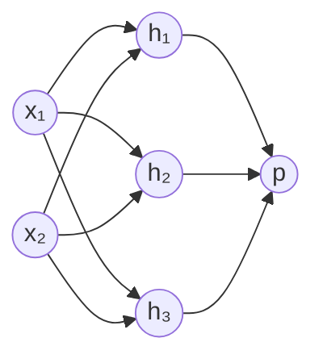
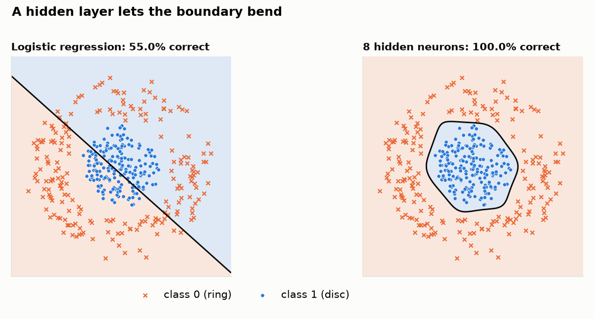
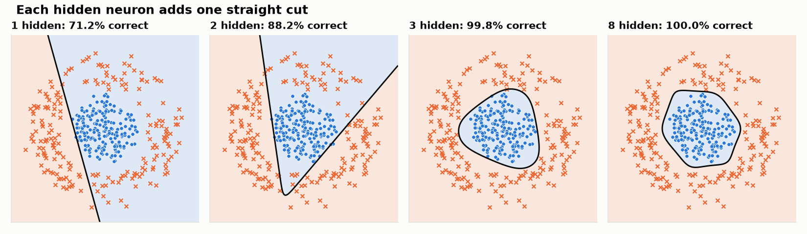
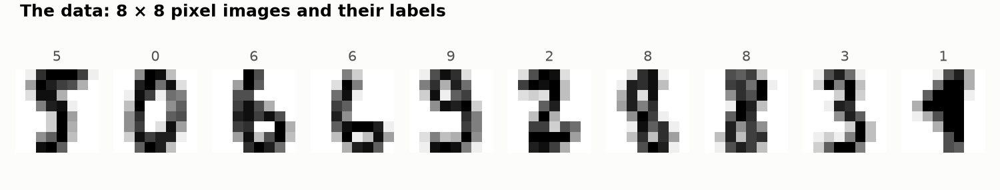
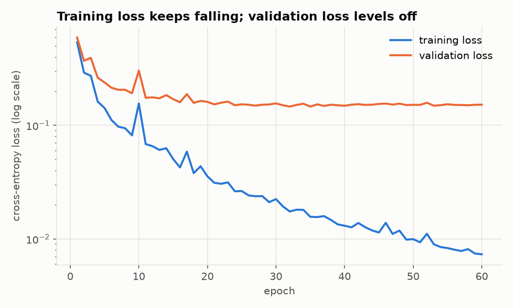
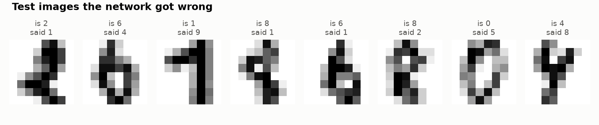

# Neural networks: stacking simple models into a powerful one

This is the third tutorial, after [linear regression](../linear-regression/README.md)
and [logistic regression](../logistic-regression/README.md). The last one
ended with a limitation and a promise:

- the limitation: logistic regression can only separate classes with a
  straight line
- the promise: a single neuron *is* logistic regression, and a neural network
  is many of them stacked in layers

This tutorial delivers on that. You already know nearly everything you need:

| Ingredient | Logistic regression | Neural network |
|---|---|---|
| **Data** | inputs with 0/1 answers | the same |
| **Model** | one neuron | layers of neurons |
| **Loss** | log loss | the same |
| **Optimiser** | gradient descent | the same, with gradients computed by **backpropagation** |

Only the model is new. Backpropagation is not a new optimiser; it is just the
method for working out the gradients when the model has layers.

## How to use this tutorial

```bash
cd neural-networks

# Lesson 1 needs nothing but Python 3
python3 01_from_scratch.py

# Lessons 2-4 need numpy, matplotlib and scikit-learn
python3 -m venv .venv
source .venv/bin/activate
pip install -r requirements.txt
python 02_numpy_network.py
python 03_digits.py
python 04_scikit_learn.py
```

| File | What it teaches |
|---|---|
| [`01_from_scratch.py`](01_from_scratch.py) | neurons, layers, forward pass and backpropagation in pure Python |
| [`02_numpy_network.py`](02_numpy_network.py) | layers as matrices, and what hidden neurons do to the decision boundary |
| [`03_digits.py`](03_digits.py) | recognising handwritten digits: softmax, ReLU, mini-batches, overfitting |
| [`04_scikit_learn.py`](04_scikit_learn.py) | the same network with a library |
| [`datasets.py`](datasets.py) | the small datasets for lessons 1 and 2 |
| [`plotting.py`](plotting.py) | shared chart styling |

---

## 1. The problem a single neuron cannot solve

XOR ("exclusive or") is the smallest dataset that defeats a straight line. The
answer is 1 when exactly one of the two inputs is 1:

| x₁ | x₂ | answer |
|---|---|---|
| 0 | 0 | 0 |
| 0 | 1 | 1 |
| 1 | 0 | 1 |
| 1 | 1 | 0 |

Draw the four points on paper: the two 1s sit on one diagonal and the two 0s
on the other. No single line puts the 1s on one side and the 0s on the other.
Logistic regression confirms it:

```
Part 1: one neuron (logistic regression)
  [0, 0]   truth = 0   P(1) = 0.50
  [0, 1]   truth = 1   P(1) = 0.50
  [1, 0]   truth = 1   P(1) = 0.50
  [1, 1]   truth = 0   P(1) = 0.50
```

It gives up and answers "50/50" for everything.

## 2. The model: neurons in layers

A **neuron** is what you built in the logistic regression tutorial: a weighted
sum of its inputs plus a bias, passed through an S-shaped function.

$$\text{output} = f(w_1 x_1 + w_2 x_2 + b)$$

The function `f` is called the **activation function**. A neural network
arranges neurons in **layers**, where the outputs of one layer are the inputs
of the next. The network in lesson 1 looks like this:



- the **input layer** is just the data: 2 numbers
- the **hidden layer** has 3 neurons; each looks at both inputs
- the **output layer** has 1 neuron; it looks at the 3 hidden neurons and
  produces the probability `p`

Every arrow is one weight, and every neuron also has a bias: 6 + 3 weights and
biases into the hidden layer, 3 + 1 into the output, 13 parameters in total.

Computing a prediction is called the **forward pass**, and it is two steps:

```python
h = [tanh(W1[j][0]*x[0] + W1[j][1]*x[1] + b1[j]) for j in range(3)]   # hidden layer
p = sigmoid(W2[0]*h[0] + W2[1]*h[1] + W2[2]*h[2] + b2)                # output layer
```

Why does this help? The hidden layer **re-describes** each input with three
new numbers, and the network learns a description in which the problem
becomes easy. After training on XOR:

```
  [0, 0]   truth = 0   P(1) = 0.00   hidden neurons: -0.97  +1.00  +0.98
  [0, 1]   truth = 1   P(1) = 1.00   hidden neurons: +0.97  +0.88  +0.56
  [1, 0]   truth = 1   P(1) = 1.00   hidden neurons: +0.97  +0.88  +0.56
  [1, 1]   truth = 0   P(1) = 0.00   hidden neurons: +1.00  -0.92  -0.74
```

In the original inputs no line separates the classes. In the hidden neurons'
values one does, and the output neuron (a plain logistic regression) finds it.
Nobody designed those three features. The network invented them because they
lower the loss. **Learning useful features instead of being handed them is the
central idea of neural networks.**

### Why the activation function matters

Without `tanh`, each layer would be a weighted sum of weighted sums, which is
just another weighted sum. A hundred layers would collapse into a single
straight line. The non-linear activation between the layers is what lets the
network bend.

## 3. Backpropagation: gradients for a layered model

Training is still gradient descent: compute the gradient of the loss for
every parameter, step the other way. The only question is how to get the
gradients for weights buried in the hidden layer, which affect the loss only
indirectly.

The answer is the chain rule, applied backwards through the network:

**Step 1: the output neuron.** Exactly as in logistic regression, the error
signal is prediction minus truth, and each weight's gradient is that error
times the weight's input:

$$\delta_{out} = p - y \qquad \frac{\partial L}{\partial W_{2,j}} = \delta_{out} \cdot h_j$$

**Step 2: pass the blame back.** How much is hidden neuron `j` responsible for
the error? It influenced the output through the weight `W2[j]`, so it gets
that share of the error, scaled by the slope of its own activation function
(the derivative of tanh is `1 − tanh²`):

$$\delta_j = \delta_{out} \cdot W_{2,j} \cdot (1 - h_j^2)$$

**Step 3: the hidden weights.** Again "error times input":

$$\frac{\partial L}{\partial W_{1,j,i}} = \delta_j \cdot x_i$$

That is the whole algorithm. In code:

```python
d_out = p - y
grad_W2 = [d_out * h[j] for j in range(HIDDEN)]

for j in range(HIDDEN):
    d_h = d_out * net["W2"][j]        # blame passed back through the weight
    d_z = d_h * (1 - h[j] ** 2)       # ...and through tanh
    grad_W1[j] = [d_z * x[0], d_z * x[1]]
```

With more layers you repeat step 2 and 3 for each one, moving backwards. The
name *backpropagation* describes exactly this: the error is propagated back,
layer by layer.

### Trust, but verify

Backpropagation is easy to get subtly wrong, so lesson 1 checks it against the
most obvious definition of a gradient: nudge one weight a tiny bit, measure
how much the loss changes, divide.

```
gradient check before training (the two columns should match):
  W1[0][0]   backprop = -0.00790306   nudging = -0.00790306
  W1[1][0]   backprop = -0.00626472   nudging = -0.00626472
  W1[2][0]   backprop = -0.00292018   nudging = -0.00292018
  largest difference: 2.02e-12
```

Nudging needs two full passes over the data *per weight*; backpropagation gets
all gradients in one backward pass. For a network with millions of weights,
that difference is what makes training possible at all.

### Why the weights start random

In the previous tutorials the weights started at zero. Here that would be
fatal: if all hidden neurons start identical, they compute the same output,
receive the same gradient and stay identical forever, behaving as a single
neuron. Small random starting values break the symmetry.

## 4. The same network with numpy

In [`02_numpy_network.py`](02_numpy_network.py) a layer is one matrix
multiplication, and all examples go through at once:

```python
H = np.tanh(X @ W1 + b1)        # hidden layer:  (400, 2) @ (2, 8) -> (400, 8)
P = sigmoid(H @ W2 + b2)        # output layer:  (400, 8) @ (8, 1) -> (400, 1)

d_out = (P - y) / n
grad_W2 = H.T @ d_out                        # error times input
d_hidden = (d_out @ W2.T) * (1 - H**2)       # blame passed back
grad_W1 = X.T @ d_hidden                     # error times input
```

The data is a disc of one class surrounded by a ring of the other, the
"ring" problem mentioned at the end of the logistic regression tutorial:



Logistic regression gets 55%, barely better than guessing. The network with
8 hidden neurons gets 100%.

### What a hidden neuron does

Train the same network with 1, 2, 3 and 8 hidden neurons:



```
logistic regression (no hidden layer):  accuracy = 55.0%
network with 1 hidden neuron(s):         accuracy = 71.2%
network with 2 hidden neuron(s):         accuracy = 88.2%
network with 3 hidden neuron(s):         accuracy = 99.8%
network with 8 hidden neuron(s):         accuracy = 100.0%
```

Each hidden neuron is a logistic regression, so each contributes one straight
cut through the plane. One cut cannot enclose a disc and two form an open
wedge, but three make a triangle, the first closed shape. More neurons give
more cuts and a rounder boundary. With enough hidden neurons a network can
approximate any shape, which is why they are so widely applicable.

## 5. A real task: handwritten digits

[`03_digits.py`](03_digits.py) uses real data: 1797 images of handwritten
digits, 8 × 8 pixels each, bundled with scikit-learn.



The network gets the 64 pixel brightness values as 64 input features and must
answer with a digit from 0 to 9. Nothing about the algorithm changes, but
four practical ideas are added.

### Ten classes: softmax

For 10 classes the output layer has **10 neurons**, one per digit. The
**softmax** function turns their raw scores into 10 probabilities that sum
to 1:

$$p_k = \frac{e^{z_k}}{\sum_j e^{z_j}}$$

It is the many-class generalisation of the sigmoid. The prediction is the
class with the highest probability, and the loss is **cross-entropy**:
`−log` of the probability given to the correct class (with two classes this
is exactly the log loss). The error signal at the output is once again
*prediction minus truth*.

### ReLU

Modern networks use the **ReLU** activation in hidden layers instead of tanh:

```python
np.maximum(z, 0)     # keep positive values, replace negative ones with 0
```

It is cheaper to compute, and its slope is exactly 1 for active neurons, so
the error signal does not shrink as it travels back through many layers. That
shrinking (the *vanishing gradient* problem) is what made deep networks hard
to train with sigmoid and tanh.

### Mini-batches

So far every update used the whole dataset. With large datasets that is
wasteful. **Mini-batch stochastic gradient descent (SGD)** shuffles the data
and updates the weights after every small batch (here 32 images). One epoch is
then 34 small, slightly noisy steps instead of one exact step, and the network
learns much faster. The noise is visible as bumps in the loss curve below.

### A validation set, and overfitting

The data is now split three ways:

- **training set** (1079 images): the network learns from these
- **validation set** (359): watched *during* training to see how it is going
  and to choose settings such as the number of hidden neurons
- **test set** (359): used once, at the end, for the final score

The validation set exists because every decision you make by looking at a
score leaks a little information about that data into your model. Keeping the
test set untouched until the end keeps the final number honest.

```
  epoch   train loss   train acc   val loss   val acc
      1       0.5386       90.7%     0.5941     88.0%
      5       0.1423       97.1%     0.2388     92.2%
     20       0.0356       99.4%     0.1612     96.1%
     40       0.0131      100.0%     0.1490     96.9%
     60       0.0073      100.0%     0.1521     96.9%
  validation loss was lowest at epoch 35 (0.1465)
```



This picture is **overfitting**, the central problem of machine learning, made
visible. The training loss keeps falling and training accuracy reaches 100%:
the network has memorised its 1079 images. But the validation loss stopped
improving around epoch 35. Everything learned after that is detail specific to
the training images that does not help with new ones. A network has enough
parameters (4810 here) to memorise, so you must always watch a curve the
network is not trained on.

### The result, honestly

```
no hidden layer  [64, 10]        650 parameters   validation accuracy = 95.0%
one hidden layer [64, 64, 10]   4810 parameters   validation accuracy = 96.9%

test accuracy of the network:       97.5%
test accuracy with no hidden layer: 96.1%
mistakes: 9 of 359 test images
```

The network makes 9 mistakes where the model with no hidden layer makes 14.
That is a real improvement but a modest one, and it is worth knowing why:
these tiny, centred digits are almost separable with straight cuts already, so
the baseline is strong. On the ring data the hidden layer was the difference
between 55% and 100%. How much a neural network helps depends on how
non-linear the problem is, which is why you always train a simple baseline
first.



Looking at the mistakes is always worthwhile. Several of these are hard for a
human too.

## 6. In practice

[`04_scikit_learn.py`](04_scikit_learn.py) trains the same architecture in two
lines:

```python
model = MLPClassifier(hidden_layer_sizes=(64,), max_iter=500, random_state=0)
model.fit(X_train, y_train)
```

It reaches 96.9% on its own test split, in line with our from-scratch result.
(MLP stands for *multi-layer perceptron*, the classic name for this kind of
network.)

scikit-learn is fine for small networks on tabular data. For anything bigger,
people use **PyTorch**. Its key feature is *automatic differentiation*: you
write only the forward pass, and the library derives the backward pass for
you. Having written `backward()` by hand twice, you know exactly what it is
automating.

## 7. What can go wrong

- **Overfitting.** More parameters mean more capacity to memorise. Cures:
  more data, a smaller network, stopping when validation loss stops improving
  (*early stopping*), regularisation.
- **Sensitivity to settings.** Learning rate, layer sizes, batch size and
  number of epochs all matter, and there is no formula for them. They are
  chosen by trying values and comparing validation scores.
- **Randomness.** Different random starting weights give slightly different
  results. One run that is 0.5% better does not prove anything.
- **No explanation.** You could read a linear model's weights. A network's
  4810 weights tell you nothing directly. When a decision must be explained,
  the simpler models still win.
- **Hungry for data.** A network usually needs more examples than a linear
  model to do well. On small tabular datasets, simpler models are often
  just as good.

## 8. Exercises

1. In `01_from_scratch.py`, change `make_network` so that all weights start at
   `0.0`. Train. What happens to the loss, and why?
2. Set `HIDDEN = 2`. Can the network still learn XOR? Try a few different
   seeds in `make_network(seed=...)`. What about `HIDDEN = 1`?
3. In `backward()`, introduce a bug on purpose: drop the `(1 - h[j] ** 2)`
   factor. Does the gradient check catch it?
4. In `02_numpy_network.py`, remove the `np.tanh` from the hidden layer (and
   the `(1 - H**2)` from the backward pass). What accuracy do you get with 8
   hidden neurons now? Relate it to "why the activation function matters".
5. In `03_digits.py`, train `[64, 8, 10]`, `[64, 256, 10]` and
   `[64, 64, 32, 10]`. Compare parameter counts and validation accuracy. Is
   bigger always better here?
6. Change `learning_rate` in `train_network` to `0.01` and then to `2.0`.
   Describe both loss curves.
7. Implement early stopping: remember the weights from the epoch with the
   lowest validation loss and use those for the test score.
8. Train on only the first 100 training images. What happens to the gap
   between training and validation accuracy?

## 9. Vocabulary

| Term | Meaning |
|---|---|
| neuron | a weighted sum of inputs plus a bias, passed through an activation function |
| activation function | the non-linear function applied by a neuron (sigmoid, tanh, ReLU) |
| layer | a group of neurons that all read the previous layer's outputs |
| hidden layer | a layer between the inputs and the output |
| forward pass | computing the prediction from the inputs, layer by layer |
| backpropagation | computing all gradients by applying the chain rule backwards |
| softmax | turns a vector of scores into probabilities that sum to 1 |
| cross-entropy | the loss for classification; log loss generalised to many classes |
| mini-batch | a small subset of the data used for one weight update |
| SGD | stochastic gradient descent: gradient descent on mini-batches |
| validation set | data held out to monitor training and choose settings |
| overfitting | memorising the training data instead of learning the pattern |
| deep learning | machine learning with networks of many layers |

## Where to go next

1. **PyTorch**: rebuild lesson 3 in it and let automatic differentiation
   write `backward()` for you.
2. **Regularisation and better optimisers**: dropout, weight decay, Adam.
3. **Convolutional networks**: layers designed for images, which look at small
   patches instead of treating every pixel as an unrelated input.
4. **Transformers**: the architecture behind large language models. Much
   bigger, but still layers, a loss, and gradient descent with backpropagation.

For the theory in depth, see the neural network chapters of
[*Data Mining and Machine Learning: Fundamental Concepts and Algorithms*](https://freecomputerbooks.com/Data-Mining-and-Machine-Learning-Fundamental-Concepts-and-Algorithms.html)
by Zaki and Meira.
