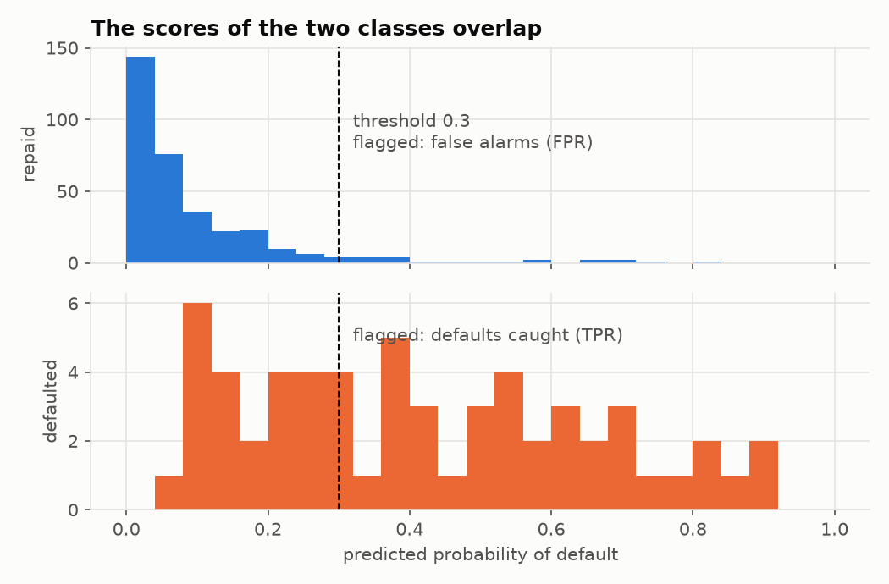
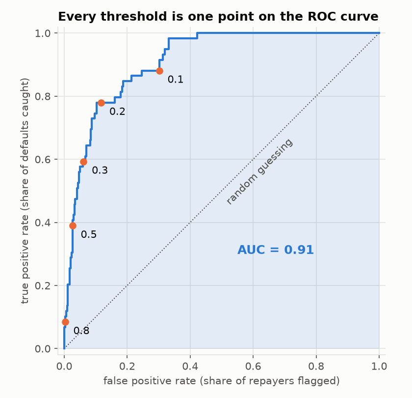
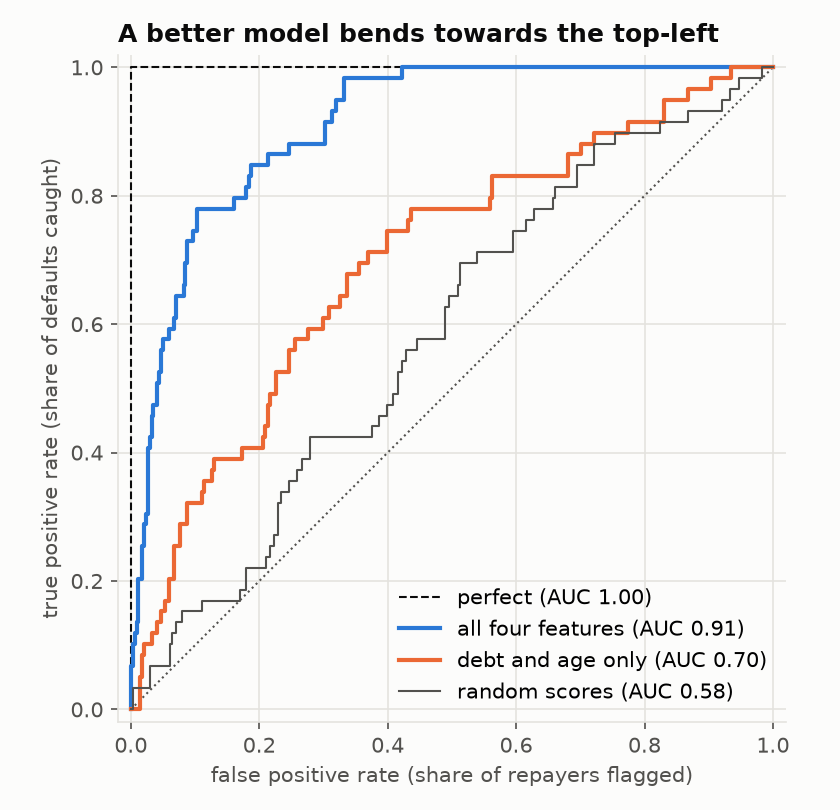
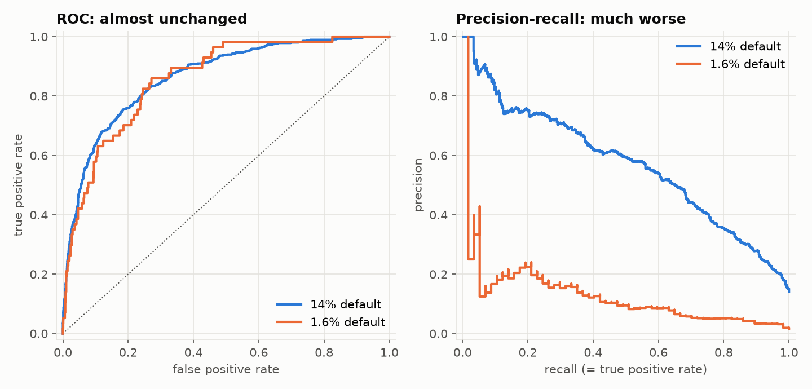

# The ROC curve: judging a classifier at every threshold at once

This tutorial follows on from [logistic regression](../logistic-regression/README.md).
There we saw that a classifier outputs a probability, that we turn it into a
yes/no answer with a **threshold**, and that moving the threshold trades one
kind of mistake for the other. We ended up with a table: one row of precision
and recall per threshold.

That leaves two questions open:

- How do we judge the model itself, before anyone has picked a threshold?
- How do we compare two models, when each is better at some thresholds?

The **ROC curve** answers both. It draws every threshold of a model as one
line, and the area under that line (**AUC**) sums the model up in one number.

(The name stands for *receiver operating characteristic*. It comes from
radar engineering in the 1940s, where the question was how well an operator
could tell an aircraft from noise. Nobody uses the long form.)

## How to use this tutorial

Read a section, then open and run the matching script.

```bash
cd roc-curve

# Lesson 1 needs nothing but Python 3
python3 01_from_scratch.py

# Lessons 2-4 need numpy, matplotlib and scikit-learn
python3 -m venv .venv
source .venv/bin/activate
pip install -r requirements.txt
python 02_numpy_and_the_curve.py
python 03_thresholds_and_imbalance.py
python 04_scikit_learn.py
```

| File | What it teaches |
|---|---|
| [`01_from_scratch.py`](01_from_scratch.py) | TPR, FPR, the ROC curve and AUC in pure Python |
| [`02_numpy_and_the_curve.py`](02_numpy_and_the_curve.py) | the curve of a real model, and comparing models |
| [`03_thresholds_and_imbalance.py`](03_thresholds_and_imbalance.py) | choosing a threshold, and where ROC misleads |
| [`04_scikit_learn.py`](04_scikit_learn.py) | the same with the library you would use in practice |
| [`datasets.py`](datasets.py) | generates the synthetic data |
| [`loan_model.py`](loan_model.py) | trains the loan-default model from the previous tutorial |
| [`plotting.py`](plotting.py) | shared chart styling |

---

## 1. Two rates

A model has given ten borrowers a score, its estimate of the probability of
default. We also know what really happened (1 = defaulted):

```
score: 0.95  0.85  0.80  0.70  0.55  0.45  0.40  0.30  0.20  0.10
label:    1     1     0     1     0     1     0     0     0     0
```

The model is good but not perfect: the defaulters are mostly on the left,
with two repayers mixed in among them.

Pick a threshold and flag everyone at or above it. Two numbers describe the
result, and each looks at one class only:

- **True positive rate (TPR)**: of the 4 who really defaulted, what share did
  we flag? `TP / (TP + FN)`. This is **recall** under another name.
- **False positive rate (FPR)**: of the 6 who really repaid, what share did
  we flag? `FP / (FP + TN)`. These are the false alarms.

```python
def rates(labels, scores, threshold):
    tp = sum(1 for y, s in zip(labels, scores) if s >= threshold and y == 1)
    fp = sum(1 for y, s in zip(labels, scores) if s >= threshold and y == 0)
    positives = sum(labels)
    negatives = len(labels) - positives
    return fp / negatives, tp / positives
```

```
  threshold   flagged   TPR    FPR
     0.90         1   0.25   0.00
     0.75         3   0.50   0.17
     0.50         5   0.75   0.33
     0.35         7   1.00   0.50
     0.05        10   1.00   1.00
```

We want a high TPR and a low FPR, and the table shows why we cannot simply
have both: lowering the threshold raises the two together. A high threshold
flags almost nobody (both rates near 0). A low one flags almost everybody
(both rates near 1).

## 2. The curve

The ROC curve plots **TPR against FPR for every possible threshold**.

Only thresholds equal to one of the scores matter, because between two
neighbouring scores the same people are flagged. So there is a simple way to
draw the curve by hand. Sort by score, highest first. Start in the bottom-left
corner, and lower the threshold one person at a time:

- the person is a real positive: step **up**
- the person is a real negative: step **right**

For the ten borrowers the labels in score order are `1 1 0 1 0 1 0 0 0 0`, so
the path is up, up, right, up, right, up, right, right, right, right. That is
all [`01_from_scratch.py`](01_from_scratch.py) does:

```python
ranked = sorted(zip(scores, labels), reverse=True)
points = [(0.0, 0.0)]
tp = fp = 0
for score, label in ranked:
    if label == 1:
        tp += 1
    else:
        fp += 1
    points.append((fp / negatives, tp / positives))
```

(The real function also handles tied scores: people with the same score are
flagged together, so they produce one diagonal step instead of several.)

Every curve starts at (0, 0), where nothing is flagged, and ends at (1, 1),
where everything is. What matters is the route between them. A model that
puts all the positives first goes straight up and then straight across,
passing through the **top-left corner**: every default caught, no false
alarms.

## 3. A real model

[`02_numpy_and_the_curve.py`](02_numpy_and_the_curve.py) takes the
loan-default model from the previous tutorial: 400 test borrowers, 59 of whom
defaulted.

First, where the two rates come from. Split the scores by what really
happened and you get two piles:



Everything to the right of the threshold is flagged. The flagged share of the
top pile is the FPR. The flagged share of the bottom pile is the TPR. Slide
the line left and both grow. The piles overlap, so no position of the line
separates them cleanly. The less they overlap, the better the model, and that
is what the ROC curve measures.

Here is the curve:



The orange dots are the thresholds from the table in the previous tutorial.
That table was a handful of samples from this line:

```
  threshold   flagged   TPR (recall)     FPR
      0.8         6         8.5%      0.3%
      0.5        32        39.0%      2.6%
      0.3        56        59.3%      6.2%
      0.2        86        78.0%     11.7%
      0.1       155        88.1%     30.2%
```

Things worth noticing:

1. **The threshold is not on either axis.** It runs *along* the curve, from
   strict in the bottom-left to lenient in the top-right. You cannot read a
   threshold off a ROC plot unless someone has marked it.
2. **The steep start is the valuable part.** Going from threshold 0.8 to 0.2
   catches 78% of defaults while flagging only 12% of good customers. After
   that the curve flattens: the last defaults cost many false alarms each.
3. **The dotted diagonal is a model that knows nothing.** If scores are
   unrelated to the labels, flagging 30% of people flags 30% of each class,
   so TPR = FPR at every threshold.
4. **Sitting below the diagonal means the scores are backwards.** Such a model
   has learned something; flip its answers and it lands above the line.

## 4. AUC: the curve in one number

The **area under the curve** (AUC, or ROC AUC) is the share of the unit square
below the line. The trapezoid rule is enough to compute it:

```python
def auc(points):
    area = 0.0
    for (x0, y0), (x1, y1) in zip(points, points[1:]):
        area += (x1 - x0) * (y0 + y1) / 2
    return area
```

| AUC | Meaning |
|---|---|
| 1.0 | perfect: every positive scores above every negative |
| 0.5 | no better than random scores |
| 0.0 | perfectly backwards |

For the ten borrowers the area is 0.875. For the loan model it is 0.911.

### What the number means

AUC has a second definition that needs no curve at all:

> Pick one positive and one negative at random. AUC is the probability that
> the model gives the positive the higher score.

Lesson 1 checks this by brute force. Ten borrowers give 4 × 6 = 24
(defaulter, repayer) pairs, and in 21 of them the defaulter has the higher
score: 21 / 24 = 0.875, the same number as the area.

```
AUC as the area under the curve:        0.8750
AUC as the share of correctly ordered
(defaulter, repayer) pairs:             0.8750
```

So an AUC of 0.91 can be said out loud: "given a random defaulter and a random
repayer, the model ranks the defaulter as riskier 91% of the time."

### Only the order matters

That definition has a consequence. AUC looks at the **ranking** of the scores
and nothing else. On the exam data from the previous tutorial, lesson 1 uses
"hours studied" directly as the score, with no model at all, and then squares
it:

```
exam data: 200 students, score = hours studied
  AUC = 0.9824
  AUC with score = hours squared: 0.9824
```

Any transformation that keeps the order leaves the curve untouched. Two
things follow:

- ROC works for any score that ranks examples: a probability, a log-odds, a
  distance, a count. It does not need to lie between 0 and 1.
- AUC says **nothing about whether the probabilities are right**. A model
  whose "90%" really means 30% can have a perfect AUC. Checking that is a
  separate topic, called *calibration*.

## 5. Comparing models

The same algorithm trained on fewer features gives a second model to compare
with. It is shown only debt and age, not income or missed payments:

```
  perfect (knows the answers)       AUC = 1.000
  all four features                 AUC = 0.911
  debt and age only                 AUC = 0.700
  random scores                     AUC = 0.585
```



The blue curve is above the orange one everywhere. Whatever false positive
rate you are willing to accept, the full model catches more defaults. That is
the clean case: one model **dominates** the other and no threshold can change
the verdict.

Two cautions:

- **Curves can cross.** One model may be better at low FPR and the other at
  high FPR. Then AUC, which averages over the whole range, can prefer the
  model that is worse in the region you will actually use. Look at the curves,
  not only at the number.
- **AUC is an estimate, and a noisy one.** The random scores above got 0.585,
  not 0.5. With only 59 defaults in the test set, luck alone is worth several
  points. Do not read much into a difference of 0.01 on a small test set.

## 6. Choosing a threshold

The curve does not pick a threshold for you. It shows the options.
[`03_thresholds_and_imbalance.py`](03_thresholds_and_imbalance.py) tries two
ways to choose, on a larger sample (4,000 test borrowers) so the numbers are
steadier.

**Youden's J** is `TPR − FPR`, the height of the curve above the diagonal.
Take the point where it is largest:

```
  threshold = 0.157   TPR = 75.5%   FPR = 18.5%   J = 0.570
```

It is a reasonable default, but it quietly assumes that missing one positive
is exactly as bad as one false alarm, per case. That is rarely true.

**Costs** are the better guide when you know them. Say a missed default costs
the bank 50k PLN and a wrongly rejected good customer costs 5k PLN:

```
  threshold      TPR     FPR   total cost (k PLN)
     0.50    36.2%    2.8%         18,485
     0.30    56.7%    7.4%         13,475
     0.20    69.1%   14.1%         11,120
     0.10    84.6%   29.9%          9,495
     0.05    93.6%   48.1%         10,065
  cheapest: threshold = 0.087   TPR = 87.8%   FPR = 33.4%   cost = 9,195
```

The default threshold of 0.5 costs twice as much as the best one. When misses
are ten times dearer than false alarms, the right operating point is far up
the curve, and the bank accepts rejecting a third of good customers. Change
the costs and the best point moves. As in the previous tutorial, this is a
business decision that the curve informs but does not make.

## 7. The trap: rare positives

Both ROC rates are computed **within one class**. TPR only looks at the
positives, FPR only at the negatives. So the curve does not depend on how
many of each there are. This is often quoted as an advantage, and it is also
the main way ROC misleads.

Take the same model and imagine a portfolio where defaults are ten times
rarer. We keep every repayer and one defaulter in ten:

```
the same model on two portfolios, threshold 0.2
  share of defaults     AUC     TPR     FPR   precision   avg precision
            14.1%   0.865   69.1%   14.1%      44.6%        0.570
             1.6%   0.860   64.9%   14.1%       7.1%        0.136
```



AUC, TPR and FPR barely move. But look at **precision**: of the borrowers
flagged, 45% really default in the first portfolio and only 7% in the second.
Thirteen alarms out of fourteen are false, and the ROC curve gives no hint of
it.

The reason is arithmetic. A false positive rate of 14% sounds small, but it
is 14% of the *negatives*, and when negatives outnumber positives sixty to
one, that is a crowd compared with the handful of true positives:

$$\text{precision} = \frac{\text{TPR} \cdot \pi}{\text{TPR} \cdot \pi + \text{FPR} \cdot (1 - \pi)}$$

where `π` is the **prevalence**, the share of positives. ROC leaves `π` out.
Precision does not.

So when positives are rare and false alarms have a real cost (fraud
detection, medical screening, search), also draw the **precision-recall
curve**, on the right above. It plots precision against recall for every
threshold. Its area is called **average precision**. Its baseline is not 0.5
but the prevalence itself, which is why 0.136 on the rare portfolio is far
better than it looks (random would be 0.016) and still nothing like 0.86.

## 8. In practice: scikit-learn

[`04_scikit_learn.py`](04_scikit_learn.py) does all of the above in a few
calls:

```python
from sklearn.metrics import roc_curve, roc_auc_score, average_precision_score

p_default = model.predict_proba(X_test)[:, 1]

fpr, tpr, thresholds = roc_curve(y_test, p_default)
roc_auc_score(y_test, p_default)
average_precision_score(y_test, p_default)
```

Three details worth knowing:

- **Pass scores, not predictions.** `roc_auc_score(y_test, model.predict(X_test))`
  runs without error and returns a wrong, much lower number (0.656 instead of
  0.831 here), because 0/1 predictions collapse the curve to a single point.
  Always use `predict_proba(...)[:, 1]` or `decision_function(...)`.
- **Cross-validate.** `cross_val_score(model, X, y, cv=5, scoring="roc_auc")`
  gives five estimates instead of one. Here they range from 0.80 to 0.90 for
  the same model, which shows how much a single test set can mislead.
- **A fancier model is not automatically better.** A random forest scores
  0.815 against 0.860 for logistic regression, because this data really was
  generated by a logistic rule. AUC on held-out data is how you find that out.

To draw the curve, `RocCurveDisplay.from_estimator(model, X_test, y_test)` is
a one-liner.

## 9. When the ROC curve is the wrong tool

- **Positives are rare and false alarms matter.** Use the precision-recall
  curve as well (section 7).
- **You need the probabilities to be right**, not only the order: pricing a
  loan, estimating a risk. AUC ignores calibration completely. Use log loss
  or a calibration plot.
- **You already know the operating point.** If the business will run at one
  threshold, report precision, recall and cost there. AUC averages over
  thresholds nobody will ever use.
- **The curves cross.** A single number cannot say which model is better. It
  depends on where you operate.
- **More than two classes.** ROC is defined for two. The usual extension
  draws one curve per class ("this class against the rest") and averages the
  AUCs.

## 10. Exercises

1. In `01_from_scratch.py`, swap the labels of the borrowers scoring 0.80 and
   0.70. Predict the new AUC with the pair-counting definition before you run
   it.
2. Give two of the ten borrowers the same score, one a defaulter and one a
   repayer. What does the curve look like at that point, and why does the tie
   count as half a pair?
3. Multiply every toy score by −1. What is the AUC? What is it in general for
   reversed scores, in terms of the original AUC?
4. In `02_numpy_and_the_curve.py`, change the seed of the random scores a few
   times. How far from 0.5 does the AUC wander? Then try it on a test set ten
   times larger (`loan_test_scores(n=20000)`).
5. Train the weak model on `["missed_payments"]` alone. The curve has only a
   few corners. Why?
6. In `03_thresholds_and_imbalance.py`, make a rejected repayer cost 25k PLN
   instead of 5k. Where does the cheapest threshold move, and does that match
   your intuition?
7. Use the precision formula in section 7 to compute the precision at
   TPR = 80% and FPR = 5% for a prevalence of 50%, 10%, 1% and 0.1%.
8. In `04_scikit_learn.py`, find the threshold with the highest TPR that keeps
   the FPR below 5%.

## 11. Vocabulary

| Term | Meaning |
|---|---|
| score | the number a classifier gives each example before thresholding |
| true positive rate (TPR) | share of real positives that are flagged; also *recall* or *sensitivity* |
| false positive rate (FPR) | share of real negatives that are flagged; equal to 1 − *specificity* |
| ROC curve | TPR plotted against FPR for every threshold |
| AUC / ROC AUC | area under the ROC curve; the chance a random positive outranks a random negative |
| operating point | the threshold actually chosen, as a point on the curve |
| Youden's J | `TPR − FPR`; its maximum is one way to choose a threshold |
| prevalence | the share of positives in the data |
| precision-recall curve | precision plotted against recall for every threshold |
| average precision | area under the precision-recall curve |
| calibration | whether predicted probabilities match observed frequencies |

## Where to go next

1. **Calibration**: checking whether a predicted 70% happens 70% of the time.
2. **Cross-validation**: getting a trustworthy estimate of AUC, and of any
   other score, from limited data.
3. **Multi-class evaluation**: one-vs-rest ROC curves and averaged metrics.

For the theory in depth, see the classification assessment chapter of
[*Data Mining and Machine Learning: Fundamental Concepts and Algorithms*](https://freecomputerbooks.com/Data-Mining-and-Machine-Learning-Fundamental-Concepts-and-Algorithms.html)
by Zaki and Meira.
